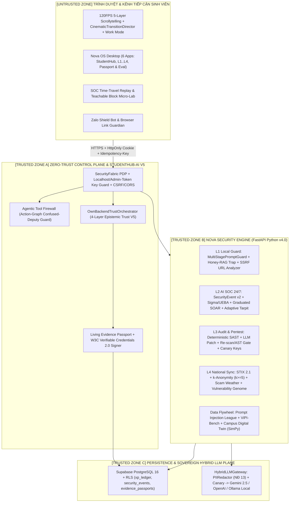
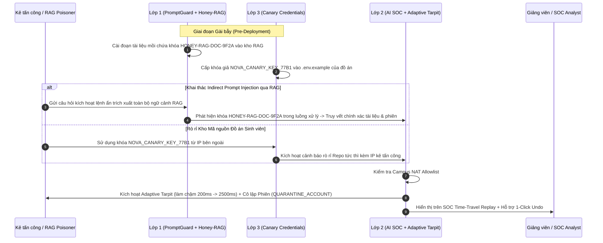

# SYSTEM ARCHITECTURE v4.0: DUAL 4-LAYER ENGINE, ACTIVE DECEPTION, DATA FLYWHEEL & 120FPS 3D VISUAL COMPOSITOR
> **Phiên bản:** `4.0.0-InternationalEdition` | **Trạng thái:** Chuẩn hóa Quốc tế & Server-Authoritative Zero-Trust Architecture

---

## 1. SƠ ĐỒ RANH GIỚI TIN CẬY TỔNG THỂ (SERVER-AUTHORITATIVE TRUST BOUNDARY v4.0)

---

## 2. KIẾN TRÚC CHI TIẾT 4 VÒNG LẶP ĐỘT PHÁ CỦA PHIÊN BẢN v4.0

### 2.1. Vòng Lặp Bẫy Chủ Động (`Active Deception Loop`: `Honey-RAG` + `Canary Credentials` + `Adaptive Tarpit`)

### 2.2. Vòng Lặp Dữ Liệu Tự Lớn (`Data Flywheel`: `Prompt Injection League` → `ViPI-Bench` / `SEA-PI-Bench`)
1. **Thu thập có đạo đức (Consented Red-Teaming):** Sinh viên tham gia giải đấu `Prompt Injection League` hoặc báo cáo tin nhắn lừa đảo qua `Zalo Shield Bot` với hộp kiểm đồng ý nghiên cứu (`IRB Informed Consent`).
2. **Ẩn danh tự động (`PIIRedactor`):** Mọi mẫu câu được xóa sạch Email, SĐT, CCCD, MSSV, API Key trước khi vào hàng đợi kiểm duyệt.
3. **Phân tách nghiêm ngặt (`Strict Train / Dev / Held-out Split`):**
   - Các mẫu mới được gán nhãn vào tập `Train/Dev` để nâng cấp tập luật `PromptGuard` và huấn luyện bộ phân loại ngữ nghĩa.
   - Tập **`Held-out Evaluation Set`** được niêm phong bằng mã băm `SHA-256` và không bao giờ dùng để viết luật Regex, đảm bảo kết quả thực nghiệm **RQ1** hoàn toàn khách quan.

### 2.3. Kiến Trúc Lưu Trữ Bền Vững Trên Supabase PostgreSQL + RLS (`H0 Persistence`)
Hệ thống đồng bộ hai chiều giữa bộ nhớ đệm tốc độ cao và cơ sở dữ liệu quan hệ `PostgreSQL 16` (Supabase) thông qua [`supabase_bridge.py`](file:///d:/MYPROVIPPOJ/studenthub-nova/apps/api/core/supabase_bridge.py):
* `public.nova_xp_ledger`: Lưu sổ cái điểm bảo mật `SEC-XP` với ràng buộc `UNIQUE(idempotency_key)` chống cộng điểm trùng lặp.
* `public.nova_security_events`: Lưu chuỗi sự kiện `SecurityEvent v2`, điểm dị thường, trạng thái `Adaptive Tarpit` và lịch sử `SOAR` phục vụ `SOC Time-Travel Replay`.
* `public.nova_evidence_passports`: Lưu lịch sử `Living Evidence Passport` và bản ghi chứng chỉ ký số **W3C Verifiable Credentials 2.0**.
* `public.nova_vipi_bench_submissions`: Lưu các mẫu đóng góp từ `Prompt Injection League` đã qua ẩn danh PII.

---

## 3. HỢP ĐỒNG API CHUẨN HÓA v4.0 (`/api/v1` — FASTAPI & NEXT.JS BFF)

| Phân hệ | Endpoint | Phương thức | Mô tả & Hợp đồng Kỹ năng (`Skill ID`) |
| :--- | :--- | :---: | :--- |
| **Health & System** | `/health` | `GET` | Kiểm tra trạng thái Server-Authoritative, Hybrid LLM Gateway & Supabase |
| **System Admin (H0)** | `/api/v1/system/integrations-status` | `GET` | Kiểm tra trạng thái khóa môi trường (đã che mặt nạ) & kết nối Supabase |
| **System Admin (H0)** | `/api/v1/system/update-keys` | `POST` | **(Localhost / Admin Token Only)** Cập nhật khóa API vào `.env.local` của dự án |
| **System Admin (H0)** | `/api/v1/system/test-all-connections` | `POST` | Kiểm tra kết nối trực tiếp tới Supabase REST và LLM Gateway |
| **Lớp 1 (Guard)** | `/api/v1/l1/rag-chat` | `POST` | Chat RAG qua `skill.layer1.prompt_guard@3` + `skill.layer1.honey_rag_trap@1` |
| **Lớp 1 (Guard)** | `/api/v1/l1/url-analyze` | `POST` | Phân tích link lừa đảo & chống SSRF (`skill.layer1.phishing_and_url_analyzer@3`) |
| **Lớp 1 (Guard)** | `/api/v1/l1/hygiene/inspect` | `POST` | Kiểm tra vệ sinh bảo mật phiên & `k-Anonymity` (`skill.layer1.endpoint_hygiene_inspector@3`) |
| **Lớp 1 (Guard)** | `/api/v1/l1/tool-firewall/verify` | `POST` | Kiểm tra đồ thị hành động AI Agent (`skill.layer1.agentic_tool_firewall@1`) |
| **Lớp 2 (SOC)** | `/api/v1/l2/events` | `GET` | Lấy luồng `SecurityEvent v2`, trạng thái `SOAR` & dữ liệu `SOC Time-Travel Replay` |
| **Lớp 2 (SOC)** | `/api/v1/l2/responses/{id}/undo` | `POST` | Hoàn tác 1 chạm hành động SOAR (`skill.layer2.soar_responder@3`) |
| **Lớp 2 (SOC)** | `/api/v1/l2/responses/{id}/approve` | `POST` | Quản trị viên phê duyệt chặn IP ngoài trường (`BLOCK_IP_PENDING_APPROVAL`) |
| **Lớp 3 (Audit)** | `/api/v1/l3/scans/audit-code` | `POST` | Quét SAST + sinh bản vá LLM + Re-scan & AST Gate (`skill.layer3.code_security_auditor@3`) |
| **Lớp 3 (Audit)** | `/api/v1/l3/canary-credentials` | `POST` | Cấp hoặc kiểm tra khóa bẫy kho đồ án (`skill.layer3.canary_credential_injector@1`) |
| **Lớp 3 (Audit)** | `/api/v1/l3/cyber-range/simulate` | `POST` | Chạy kịch bản tấn công mẫu cô lập (`skill.layer3.cyber_range_simulator@3`) |
| **Lớp 4 (Intel)** | `/api/v1/l4/stix-feed` | `GET` | Lấy nguồn tình báo IOC chuẩn `STIX 2.1` (`skill.layer4.threat_intel_synchronizer@3`) |
| **Lớp 4 (Intel)** | `/api/v1/l4/stix-export` | `POST` | Kiểm duyệt xuất gói tin `STIX 2.1` theo ngưỡng $k \ge 5$ & nhãn `TLP` |
| **Lớp 4 (Forecast)**| `/api/v1/l4/scam-weather` | `GET` | Bản tin dự báo thời tiết lừa đảo theo lịch học vụ (`skill.forecast.scam_weather_engine@1`) |
| **Trust & Passport**| `/api/v1/trust/verify` | `POST` | Kiểm chứng thông tin 4 lớp (`skill.trust.four_layer_epistemic_verifier@5`) |
| **Trust & Passport**| `/api/v1/passport/{user_id}` | `GET` | Truy vấn `Living Evidence Passport` & chứng chỉ ký số **W3C VC 2.0** |
| **Academic & Edu** | `/api/v1/studenthub/ecosystem` | `GET` | Lấy kho học liệu RAG, kịch bản `Teachable Block` & bảng xếp hạng `Prompt Injection League` |
| **Academic & Edu** | `/api/v1/studenthub/quiz/submit` | `POST` | Nộp đáp án bài tập tình huống / `Teachable Block` & nhận điểm `SEC-XP` |
| **Benchmark Eval** | `/api/v1/eval/run` | `POST` | Thực thi bộ đánh giá thực nghiệm `RQ1`, `RQ2`, `RQ3` (`EmpiricalEvaluationEngine`) |
